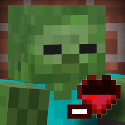

# Damage Display



Spigot plugin that shows combat feedback: floating damage/heal numbers and action bar messages.

Requires **Java 21+** and a **26.2** Spigot-compatible server (`api-version: 26.2`).

## Features

- Floating `TextDisplay` holograms on damage (optional heal holograms)
- Action bar for damage dealt and damage taken
- Uses **final damage** (after armor/resistance), not raw damage
- Configurable `&` color formats, TextDisplay style, and rise motion
- Nearby-player gate, concurrent caps, viewer scoping
- `/dd toggle [actionbar|heals]` per-player preferences (YAML)
- GitHub Actions: PR tests + `v*` tag releases

## Installation

1. Download the latest release jar (or build with Maven)
2. Put it in your server `plugins/` folder
3. Restart the server
4. Edit `plugins/DamageDisplay/config.yml` and run `/dd reload`

## Commands

| Command | Permission | Description |
|---------|------------|-------------|
| `/dd help` | `damagedisplay.command.help` | List commands you can use |
| `/dd info` | `damagedisplay.command.info` | Show plugin version and config keys |
| `/dd toggle` | `damagedisplay.command.toggle` | Toggle action bar (same as `actionbar`) |
| `/dd toggle actionbar` | `damagedisplay.command.toggle` | Toggle action bar messages |
| `/dd toggle heals` | `damagedisplay.command.toggle` | Toggle heal holograms for yourself |
| `/dd reload` | `damagedisplay.command.reload` | Reload config and player prefs |

Aliases: `/damagedisplay`

## Permissions

| Permission | Default | Description |
|------------|---------|-------------|
| `damagedisplay.enabled` | true | See action bars and holograms |
| `damagedisplay.command.toggle` | true | Use `/dd toggle` |
| `damagedisplay.command.help` | op | Use `/dd help` |
| `damagedisplay.command.info` | op | Use `/dd info` |
| `damagedisplay.command.reload` | op | Use `/dd reload` |

## Configuration

`plugins/DamageDisplay/config.yml` (defaults below). Colors use legacy `&` codes. Placeholders: `{damage}`, `{cause}`, `{amount}`.

```yaml
actionbar:
  damageDealt:
    enabled: true
    format: "&e★ Damage Dealt: &e{damage}"
  damageReceived:
    enabled: true
    format: "&c☠ Damage Taken: &c{damage}&7 | &7{cause}"

displayText:
  enabled: true
  lingertime: 10
  nearbyRange: 16
  onlyFromPlayers: false
  maxTotal: 64
  maxPerChunk: 8
  viewerScoped: true
  format: "&c{damage}"
  critFormat: "&6✴{damage}"
  billboard: VERTICAL
  shadow: true
  seeThrough: false
  background: true
  textOpacity: 255
  scale: 1.0
  motion:
    enabled: true
    riseBlocks: 0.6

heals:
  enabled: false
  format: "&a+{amount}"
```

Player toggles are stored in `plugins/DamageDisplay/player-prefs.yml`. An old `cache.dat` is migrated automatically on first load.

## Build

```bash
mvn clean package
```

Jar: `target/DamageDisplay-<version>.jar`

Tests: `mvn test`

## Releases

Push a tag on `master`:

```bash
git tag v1.2.0
git push origin v1.2.0
```

CI runs tests, sets the Maven version from the tag, and publishes the jar on GitHub Releases.

## Support

Bugs and PRs: [GitHub repository](https://github.com/JustKato/DamageDisplay).

## License

[MIT License](./LICENSE)
